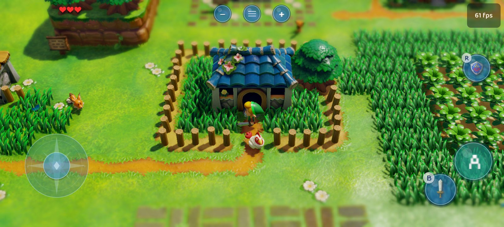
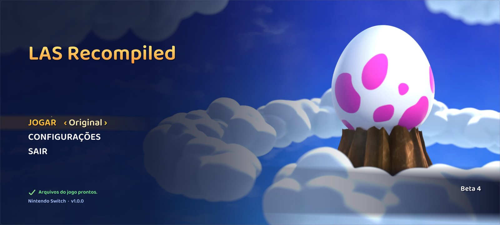

# LAS Recomp for Android

**A native Android port of [LAS Recomp](https://github.com/peiikai/LASRecomp)**: *The Legend of Zelda: Link's
Awakening* (Nintendo Switch, 2019), statically recompiled to native ARM64 code and running on your phone at up to 60
frames per second - **not emulation**. This repository is a fork of peiikai's project, focused on mobile: touch
controls designed for the game, a phone-tuned Vulkan renderer, frame generation, and an app that sets everything up on
the phone itself from your own game package.

> [!IMPORTANT]
> **No game files are included.** You need your own legally obtained copy of *Link's Awakening* **v1.0.0** (an `.xci`
> or `.nsp` dumped from your own cartridge or console, together with the `prod.keys` from your own Switch - or the
> extracted `exefs` / `romfs` folders). The app contains nothing from the game; it builds the game code on your phone
> from your files. Instructions on how to obtain them will **not** be provided.

> [!NOTE]
> Like the original project, this port was made almost entirely with AI (Anthropic's Claude, through Claude Code),
> directed, tested and reviewed by a human. You run the code at your own discretion.

## Download

Get the latest APK from the **[Releases page](https://github.com/Nycolazs/LASRecomp-Android-Plus/releases/latest)**.

## How it runs - Galaxy S20 FE (Snapdragon 865)

Developed and tested on a **Samsung Galaxy S20 FE** (Snapdragon 865, Adreno 650, 6 GB RAM, Android 16 custom ROM)
with the Mesa **Turnip** driver bundled in the app:

| | |
|---|---|
| Frame rate | **60 fps on screen** (the game's own 30 fps plus a generated in-between frame), at 1x internal resolution |
| GPU time | ~24.5 ms per game frame in the overworld at 1x (1920x1080 internal, upscaled with Snapdragon Game Super Resolution) |
| First setup | **~11 minutes** on the phone: 33 s to extract the game from an `.xci`, ~11 min to build the game code |
| Thermals | 1x + frame generation holds 60 for long sessions; 1.25x / 1.5x (native 1080p) need the "GPU performance" power mode |

Faster phones (Snapdragon 8 Gen 1 and newer) should have room for higher resolutions.

## Features

**Made for the phone**
- **Set up from your game package**: choose your `.xci` or `.nsp`, then your `prod.keys`; the app decrypts and
  extracts the game on the phone. A package with the update inside works the same - the base v1.0.0 is used. A folder
  with the extracted `exefs` / `romfs` works too. The game files can go on a **memory card** (Settings > Prelaunch >
  Storage).
- **Saves to and from Switch emulators**: import your progress from yuzu / Eden / Citron / Sudachi / Ryujinx, or
  export it to them (Settings > Prelaunch > Saves; the saves already there are backed up first).
- **The game code is built on the phone** (a bundled Python + Clang toolchain): no computer needed, ~11 minutes once.
  Functions the game never runs are compiled without optimization - the result plays the same, built in less than
  half the time.
- **Touch controls that follow the game**: only the buttons the game uses right now are on screen - B appears with
  the sword, R with the shield, L with the Pegasus Boots, X / Y with the items you equip, each showing the game's own
  item icon. On the title screen a tap starts the game, on the file select a tap on a file loads it, on the Items page
  a tap on an item selects it.
- **Your layout**: drag any button, resize or hide it (Settings > Controls > Edit touch layout).
- **Controllers**: Bluetooth / USB controllers are supported through SDL3 and play as on the Switch (not yet tested
  on the phone above - reports welcome); the touch controls hide while one is in use and come back with a touch. Face buttons go by their letters (A = the
  bottom button) by default, or by position as on a Switch (Settings > Controls > Face buttons); the in-game button
  icons follow. **Select + Start** (Minus + Plus) opens the settings menu; so do the Android back button
  and the menu button on screen.
- **60 fps frame generation**: an in-between frame reprojected from the game's depth and camera, Link held in place,
  the HUD kept still. Or the game's **native 60 fps** mode on phones fast enough for it (Settings > Video > Frame
  rate).
- **Any GPU driver**: install a Vulkan driver package (`.zip`, as emulators use) on any phone - Mesa Turnip for
  Adreno, Mesa PanVK for Mali... (Settings > Video > GPU driver). If the phone's own driver can't start the game, the
  app offers to install one right away.
- Snapdragon Game Super Resolution upscaler, dynamic resolution, pre-rotated swapchain, power modes (Balanced / GPU
  performance / maximum performance on rooted phones), custom Turnip driver loading (adrenotools).
- **Brazilian Portuguese**: the app's menus, and the game itself through the fan translation by **Projeto Zelda Brasil
  - Heroes of Time** - optional, under Settings > Language. The APK carries it only as a patch: the app makes the
  translated text from your own game files, so nothing of the game ships with it.

**From LAS Recomp** (see [the original project](https://github.com/peiikai/LASRecomp) for the full list): the in-game
overlay menu, the randomizer (seeds made on a computer can be played), unlocked aspect ratio, 360-degree movement,
blur removal, cheats, the warp menu, the save editor and more.

## Requirements

- An **arm64 Android phone, Android 11 or newer**. Adreno (Snapdragon) GPUs are what it's built and tested for; the
  bundled Turnip driver supports Adreno 6xx / 7xx. Mali, Xclipse and other GPUs run through the phone's own Vulkan
  driver (1.3, or 1.1 with the needed extensions) or one you install (e.g. Mesa PanVK on Mali).
- About **12 GB free** during the setup (the game files, the build); about 7 GB stays afterwards.
- Your own *Link's Awakening* **v1.0.0**: `.xci` / `.nsp` + `prod.keys`, or the extracted `exefs` and `romfs`.

## Installing

1. Download the APK from the [Releases page](https://github.com/Nycolazs/LASRecomp-Android-Plus/releases/latest) and install it
   (allow installing from your browser / file manager when Android asks).
2. Copy your game package (`.xci` or `.nsp`, not a compressed `.nsz` / `.xcz`) and your `prod.keys` to the phone,
   for example into `Download/LAS`.
3. Open the app: **Game file (.xci / .nsp)** -> choose your game, then your **prod.keys** when asked -> **Set up game
   files**. Keep the app open for the first seconds (the extraction), then the build continues in the background with
   a notification (about 11 minutes on a Snapdragon 865). The game starts by itself when it's done.
4. Play with the touch controls or a controller. The button at the top centre (or Select + Start, or Android's back
   button) opens the settings.

Everything the app keeps (saves, settings, the game files it extracted, caches) lives in
`Android/data/com.lasrecomp.android/files/`. Uninstalling the app deletes that folder - copy `save` out first.

## Building from source

The app (runtime, SDL3, Vulkan backend) is built with Gradle and the Android NDK 27.2:

    tools/android/build_deps.sh                          # FFmpeg, shaderc, Vulkan headers, VMA, volk, SDL3
    tools/android/ondevice/build_all.sh                  # the on-phone builder: Python, zig, the generator kit
    cd android && ./gradlew assembleRelease -PonDeviceBuild=true

`tools/android/ondevice/check_public_apk.sh <apk>` checks that an APK carries no game code or data. Building the game
code on a computer instead (a personal APK): `tools/android/build_game.sh <game folder> --apk`. Details:
[docs/android-ondevice-build.md](docs/android-ondevice-build.md) and the port's work log
[docs/android-plan.md](docs/android-plan.md) (in Portuguese).

## Known issues

- Tested on one phone (Snapdragon 865). Reports from other devices are welcome: open an issue with the phone model,
  the GPU driver and `lasrecomp.log` from the app's data folder.
- The first setup needs the app's data folder on internal storage, and the phone gets warm during the build.
- Changing the internal resolution while playing is best done on the title screen.

## Thanks

- **[peiikai](https://github.com/peiikai)** and every contributor of
  **[LAS Recomp](https://github.com/peiikai/LASRecomp)** - this port is built on their recompilation, runtime and
  randomizer work. Bugs of this fork belong here, not there.
- **[mamcjr/LASRecompAndroid](https://github.com/mamcjr/LASRecompAndroid)** (MIT) - another Android port; ideas from
  it are used here (the shader translator's jump-table windows and tables, CPU-only performance hints, render-thread
  savings).
- **Projeto Zelda Brasil - Heroes of Time** - the Brazilian Portuguese fan translation of the game.
- **Mesa / Turnip** (MIT) - the open-source Adreno Vulkan driver bundled with the app, loaded with
  [libadrenotools](https://github.com/bylaws/libadrenotools) (BSD-2-Clause).
- **Snapdragon Game Super Resolution** (BSD-3-Clause), Qualcomm.

## Credits (LAS Recomp)

**Contributors** - thank you to everyone who has sent code (GitHub handles, in order of first contribution):
- **[@dvilelaf](https://github.com/dvilelaf)** - the System language setting (#15), packaging fix for the game code
  generator helper (#10), and the task forwarder fix for the level-transition crash (#34, issue #19)
- **[@Tensorlong](https://github.com/Tensorlong)** - Metal half-precision fix for the white Link on M1 Macs (#18)
- **[@mansarip](https://github.com/mansarip)** - support for unrecognised controllers through a simple mapping file (#26)
- **[@we11adam](https://github.com/we11adam)** - shared fonts served per language instead of one Japanese font (#27),
  and the zh-Hans / zh-Hant codes for Chinese (#25)
- **[@Maganra](https://github.com/Maganra)** - Linux page write tracking (userfaultfd + PAGEMAP_SCAN) for the Vulkan
  vertex cache and texture checks (#42)
- **[@hjqcan](https://github.com/hjqcan)** - centralized game patch and runtime addresses (#57); CRLF settings
  parsing and Traditional Chinese locale detection (#53); Windows game thread stacks reserved instead of committed,
  about 9 GB less memory committed (#107); the Vulkan fence fix for reused submission slots (#108); x86 rounding
  without x87 state changes (#115); movie memory freed on close, source change and reboot (#112); Vulkan stopping
  cleanly on GPU timeouts (#127); a strict Vulkan validation mode for automated tests (#128); Windows session logs:
  `lasrecomp.log` always the latest run, with five backups (#114); resumable game-code builds: a cancelled or interrupted setup picks up where it stopped (#56); randomizer check flags kept with committed saves (#170); save write fixes that keep a failed save from losing data (#169, merged in #182)
- **[@gitarre1234rr5](https://github.com/gitarre1234rr5)** - controller rumble: the game's vibration on your controller
  (#104), and a regression test for the kernel's timed condition-variable wait (#88)
- **[@rkammoun](https://github.com/rkammoun)** - diagnosed and patched the Metal 16-sampler limit behind the black walls in the Ukuku Prairie cave (#215, fixed in #216)

Thanks also to everyone who reports issues and tests builds; your logs and screenshots find most of the bugs.

**LAS-Randomizer** - the randomizer at the heart of this project's randomizer features, vendored (with local
changes) in `third_party/LAS-Randomizer` under the MIT license. Huge thanks to its authors and community:
- **Owen_Splat** - LAS-Randomizer (https://github.com/Owen-Splat/LAS-Randomizer)
- **Glan** - created the original early builds of the randomizer (https://github.com/la-switch/LAS-Randomizer)
- **ProfessorLaw** - additional programming
- and everyone who has reported bugs, given feedback or contributed to LAS-Randomizer

**Community mods** - some options re-implement ideas from these GameBanana mods (re-implemented in the recomp;
none of their files are used):
- **360 Controls (And More!)** by Owen_Splat - 360-degree movement, blur removal (blur removal patch by theboy181)
  (https://gamebanana.com/mods/659802)
- **XBOX UI** by fellow_demo - Xbox button prompts (https://gamebanana.com/mods/540069)
- **PS4 UI Buttons** by messiahgov - PlayStation button prompts (https://gamebanana.com/mods/324458)
- **No Hero Mode Indicator** by Boo/Calla - hide the Hero Mode icon (https://gamebanana.com/mods/441172)

**Libraries and tools**
- [SDL 3](https://libsdl.org) - windowing, input, audio (zlib license)
- [FFmpeg](https://ffmpeg.org) - movie playback (LGPL)
- [Dear ImGui](https://github.com/ocornut/imgui) - overlay menu and start screen (MIT)
- [Baloo 2](https://github.com/EkType/Baloo2) by Ek Type - the start screen's font (SIL Open Font License 1.1, `third_party/fonts/Baloo2/OFL.txt`)
- [Vulkan Memory Allocator](https://github.com/GPUOpen-LibrariesAndSDKs/VulkanMemoryAllocator) - Windows and Linux renderer (MIT)
- [SMAA](https://github.com/iryoku/smaa) by Jorge Jimenez, Jose I. Echevarria, Belen Masia, Fernando Navarro and Diego
  Gutierrez - the anti-aliasing option (MIT, `third_party/smaa/LICENSE.txt`)
- [AMD FidelityFX Super Resolution 1](https://github.com/GPUOpen-Effects/FidelityFX-FSR) - the Windows and Linux upscaler
  option, ported to GLSL (MIT)
- [oead](https://github.com/zeldamods/oead) and [evfl](https://github.com/zeldamods/evfl) - Nintendo file formats, used by LAS-Randomizer
- [PyInstaller](https://pyinstaller.org) - packs the seed generator into a standalone helper (GPL 2.0+ with the
  bootloader exception, which allows distributing the packed program). The helper bundles CPython (PSF License),
  oead / evfl (GPL 2.0+), [Keystone](https://www.keystone-engine.org) (GPL 2.0; Python bindings BSD), quicktex
  (LGPL 3), Pillow (MIT-CMU), PyYAML (MIT) and appdirs (MIT)
- [Zig](https://ziglang.org) - its C compiler (`zig cc`: Clang and LLD) builds the game code on the player's
  machine during setup (MIT; LLVM, Clang, LLD: Apache 2.0 with LLVM exceptions)
- The game code generator (`tools/gen.py`) is packed by PyInstaller into a standalone helper too. It bundles CPython,
  [Capstone](https://www.capstone-engine.org) (BSD 3-clause; disassembly), [Unicorn](https://www.unicorn-engine.org)
  (GPL 2.0; Python bindings BSD; runs small pieces of code to resolve jump tables) and
  [python-lz4](https://github.com/python-lz4/python-lz4) (BSD 3-clause, with the LZ4 library: BSD 2-clause)
- [envytools](https://github.com/envytools/envytools) - NVIDIA GPU documentation used for the shader translator
- **Dusklight** by the TwilitRealm team (https://github.com/TwilitRealm/dusklight) - design inspiration for the start
  screen (Play / Settings / Game Files layout)
- The Switch homebrew community's documentation ([Switchbrew](https://switchbrew.org))

## Legal

LAS Recomp is a fan project. It is not affiliated with, endorsed by or sponsored by Nintendo. *The Legend of Zelda*
and *Link's Awakening* are trademarks of Nintendo. No game files, game code, assets or fonts are included - not in
this repository and not in release builds. You must provide your own legally obtained copy of the game files to play.

## License

LAS Recomp's own code (the recompiler tools, the runtime, the randomizer additions) is open source under the
[MIT License](LICENSE). Third-party components keep their own licenses: LAS-Randomizer (MIT), Dear ImGui (MIT),
Vulkan Memory Allocator (MIT), SMAA (MIT), AMD FSR 1 (MIT), the Baloo 2 font (SIL OFL 1.1), SDL 3 (zlib), FFmpeg (LGPL 2.1+, linked dynamically), the
Zig compiler (MIT; its LLVM / Clang / LLD: Apache 2.0 with LLVM exceptions; its C library headers keep their own
licenses), and the generator helpers' bundled libraries listed under Credits (oead / evfl / Keystone in the seed
generator and Unicorn in the game code generator are under the GPL, versions in the table below: each helper is a separate program the game runs, and its
sources are this repository plus those projects' published sources). The license covers LAS Recomp's code only - it grants
nothing for Nintendo's game, which you must supply yourself.

### Source code of bundled third-party components

Release builds include these components; their source code for the exact versions shipped is available here:

| Component | Version | License | Source |
|---|---|---|---|
| Keystone (seed generator) | 0.9.2 | GPL 2.0 | https://github.com/keystone-engine/keystone/releases/tag/0.9.2 |
| oead (seed generator) | 1.3.0 | GPL 2.0+ | https://github.com/zeldamods/oead/releases/tag/v1.3.0 |
| evfl (seed generator) | 1.2.0 | GPL 2.0+ | https://github.com/zeldamods/evfl/releases/tag/v1.2.0 |
| quicktex (seed generator) | 0.2.1 | LGPL 3.0 | https://github.com/drewcassidy/quicktex/releases/tag/v0.2.1 |
| PyInstaller (packs the seed and game code generators) | 6.22.3 | GPL 2.0+ with bootloader exception | https://github.com/pyinstaller/pyinstaller/releases/tag/v6.22.3 |
| CPython (seed and game code generators) | 3.12.14 (macOS), 3.12.10 (Windows), 3.12.15 (Linux) | PSF | https://github.com/python/cpython/releases/tag/v3.12.14, https://github.com/python/cpython/releases/tag/v3.12.10, https://github.com/python/cpython/releases/tag/v3.12.15 |
| Zig (builds the game code during setup; includes LLVM, Clang, LLD) | 0.17.0 | MIT; LLVM: Apache 2.0 with LLVM exceptions | https://ziglang.org/download/0.17.0/zig-0.17.0.tar.xz |
| Capstone (game code generator) | 5.0.9 | BSD 3-clause | https://pypi.org/project/capstone/5.0.9/ |
| Unicorn (game code generator) | 2.1.4 | GPL 2.0 (Python bindings: BSD) | https://pypi.org/project/unicorn/2.1.4/, https://github.com/unicorn-engine/unicorn |
| python-lz4 (game code generator; includes LZ4) | 4.4.5 | BSD 3-clause; LZ4: BSD 2-clause | https://pypi.org/project/lz4/4.4.5/ |
| FFmpeg (LGPL configuration, macOS, Windows and Linux builds) | 9.0.2 | LGPL 2.1+ | https://ffmpeg.org/releases/ |
| SDL 3 | 3.4.18 (macOS, Windows), 3.4.16 (Linux) | zlib | https://github.com/libsdl-org/SDL/releases/tag/release-3.4.18, https://github.com/libsdl-org/SDL/releases/tag/release-3.4.16 |
| shaderc (Windows, Linux: GLSL to SPIR-V; Linux: with glslang, SPIRV-Tools inside) | 2026.4 (Windows), 2026.3 (Linux) | Apache 2.0 | https://github.com/google/shaderc |
| libiconv (Windows: used by SDL 3) | 1.19 | LGPL 2.1+ | https://ftp.gnu.org/pub/gnu/libiconv/libiconv-1.19.tar.gz |
| GCC runtime: libgcc, libstdc++ (Windows) | 16.2.0 | GPL 3.0 with the GCC Runtime Library Exception | https://gcc.gnu.org/ |
| winpthreads (Windows, mingw-w64) | 14.0.0 | MIT / BSD | https://www.mingw-w64.org/ |
| Baloo 2 font (SemiBold) | 1.640 | SIL OFL 1.1 | https://github.com/EkType/Baloo2 |
| SMAA (shader and lookup textures, built in) | 2013 (repository master) | MIT | https://github.com/iryoku/smaa |

The exact build scripts that fetch and build these (with checksums) are in this repository: `tools/build_deps_macos.sh`,
`tools/build_deps_windows.sh`, `tools/linux/build_deps.sh` and `tools/rando/rando_gen.spec`. The Windows build takes SDL 3, shaderc, libiconv and the
compiler runtime from MSYS2's UCRT64 packages (https://packages.msys2.org, which links each package's source).
